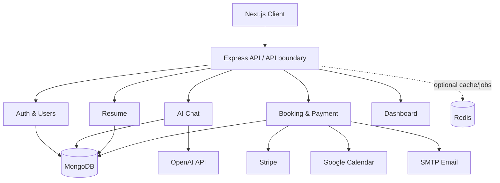

# Career Platform — AI-powered career & consultation app

A TypeScript monorepo with a Next.js frontend and modular Express API. It includes authentication, profile management, persistent AI chat, structured resumes and templates, consultation booking, Stripe Checkout/webhooks, Google Calendar and email integration hooks, Swagger documentation, Docker, and tests.

## Architecture

The services are implemented as modules in one deployable API to keep local development reliable and reduce deployment overhead for a 36-hour assessment. Modules have separate routes, models and integration adapters and can later be extracted behind an API gateway. MongoDB is the source of truth. Chat messages and booking/payment records use references; resume content is stored as structured data. Stripe webhooks—not browser redirects—confirm payments.

## Requirements
- Node.js 20+
- npm 10+
- MongoDB 7+ (or Docker)
- Optional: Redis, OpenAI API key, Stripe account/CLI, Google Calendar credentials, SMTP account

## Local setup
1. Copy `.env.example` to `.env` and set a strong random `JWT_SECRET`.
2. Add only credentials you own. Leave optional integrations blank if not testing them.
3. Install dependencies: `npm install`
4. Start MongoDB locally, or run `docker compose up mongo redis -d`.
5. Start API and web: `npm run dev`
6. Web: http://localhost:3000; API: http://localhost:5000; Swagger: http://localhost:5000/api-docs; health: http://localhost:5000/health

For a full Docker launch, configure `.env` first, then run `docker compose up --build`.

## Main routes
- `POST /api/auth/register`, `POST /api/auth/login`, `GET /api/auth/me`, `POST /api/auth/logout`
- `GET/PATCH /api/users/me`
- `GET/POST /api/chat/sessions`, `GET/PATCH/DELETE /api/chat/sessions/:id`, `POST /api/chat/sessions/:id/messages`
- `GET/POST /api/resumes`, `GET/PATCH/DELETE /api/resumes/:id`, `POST /api/resumes/:id/generate`
- `GET /api/consultants`, `GET/POST /api/bookings`, `GET /api/bookings/:id`
- `POST /api/payments/checkout`, `POST /api/payments/webhook` (raw Stripe webhook endpoint)
- `GET /api/dashboard`

All protected routes use `Authorization: Bearer <token>`. Swagger is available at `/api-docs`.

## Stripe webhook
Set `STRIPE_SECRET_KEY` and `STRIPE_WEBHOOK_SECRET`. In local development, use Stripe CLI to forward events to `localhost:5000/api/payments/webhook`. Only a verified `checkout.session.completed` event marks a booking paid. Duplicate event IDs are persisted and ignored. The success URL is informational only.

## AI and resume generation
Set `OPENAI_API_KEY`. If missing, AI routes return a clear configuration error rather than fake generated output. Resume generation asks for JSON-shaped content and validates the result before saving. Never expose API keys to the browser.

## Calendar and email
Google Calendar and SMTP are optional integrations. Configure Google OAuth client ID/secret/refresh token and SMTP settings to enable them. Booking remains paid if calendar/email integration fails; failures are logged and can be retried operationally. For production, move these side effects to a durable queue/outbox worker and add retry/backoff.

## Security notes
- Passwords use bcrypt hashing; JWT secret is required in production.
- Input is validated with Zod; API errors do not return stack traces.
- Authenticated ownership is checked for user-owned records.
- Helmet, CORS allow-list, and rate limiting are enabled.
- Keep `.env` private. Never commit credentials.
- Production hardening still recommended: refresh-token rotation, email verification, CSRF strategy if using cookies, audit logs, request IDs, durable outbox, and stronger consultant/admin workflows.

## Tests
`npm test -w apps/api`. The suite covers the health endpoint, unauthenticated access to protected chat routes, and booking state transitions. Expand with integration tests using a dedicated test MongoDB, Stripe webhook signature fixtures, and frontend Playwright tests before production deployment.

## Vercel deployment
The repository deploys as one Vercel project. Next.js serves the web application and `api/[...path].ts` adapts the Express API to a serverless function. Set `MONGODB_URI`, `JWT_SECRET`, and the optional integration variables in the Vercel project Production environment. The frontend defaults to same-origin `/api` calls.

## Known limitations / trade-offs
- This is an assessment-ready functional foundation, not a claim of fully audited production software.
- Consultant availability is represented by active consultant records and a conservative overlap check; for high concurrency, use a slot reservation collection with a unique compound index or a transaction-based reservation flow.
- Calendar/email side effects are adapters and fail safely; a durable outbox worker is the recommended next step.
- Payment amount is taken from the server-side consultant record, not client input.
- Redis is provisioned but caching is not required for correctness.
- Export/print is browser-based; PDF generation can be added with a server-side renderer.
- For one million users: split independently scaling modules, add queue/outbox workers, CDN and object storage, MongoDB replica/sharding strategy based on measured query patterns, Redis cache with invalidation, observability, autoscaling, and load tests.

## Suggested commit sequence
1. scaffold monorepo and environment configuration
2. authentication and user profile
3. chat and AI provider adapter
4. resume schema and rendering
5. booking and Stripe webhook
6. frontend integration
7. tests, docs and deployment
